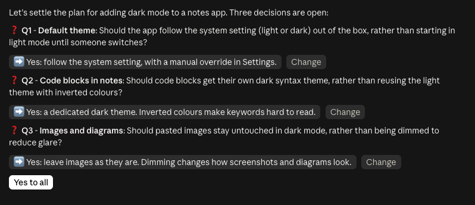

# claude-mods

Mods for Claude Code: plugins of function hooks that draw panes and react to what a session does.

## ticket-board

A live board of an `/implement-spec` run. Each ticket in `.scratch/<feature>/issues/` is a card in a column (Blocked, Ready, In progress, Needs you, Done). An agent's card shows what it is doing right now. Clicking the card opens that agent's conversation in the pane, live, and its Message button sends the agent a correction directly. The card of the agent you have open in the main view is marked.

An agent joins the board when its prompt names a `.scratch/<feature>/` path. Name agents after their ticket (`VI-9-02`, `merge-VI-9-02`) to put them on the right card. Open the board with `/board`; it also opens by itself when the first ticket agent starts.

## grill-answers

Answer a `/grilling` round by clicking instead of typing. In the newest unanswered round, each `➡️` recommendation becomes a button where it stands: clicking it writes `Q2: yes` into the prompt box, and the Change button beside it writes `Q2: ` for an answer of your own. Press Enter to send what the prompt box holds, or click Yes to all to send `yes to all` at once. A round of one question sends `yes` from its recommendation. Once any prompt is sent, the round reads as plain text again.



## Install

In a Claude Code terminal session:

```
/plugin install ticket-board --marketplace sandergo90/claude-mods
/plugin install grill-answers --marketplace sandergo90/claude-mods
```

Answer `y` to add the marketplace, then pick a scope.

## Develop

Run a mod's tests with `claude plugin test ticket-board`, and check it with `claude plugin validate ticket-board`. With the marketplace added from a local clone (`claude plugin marketplace add <clone>`), `/reload-plugins` picks up edits without a reinstall.
